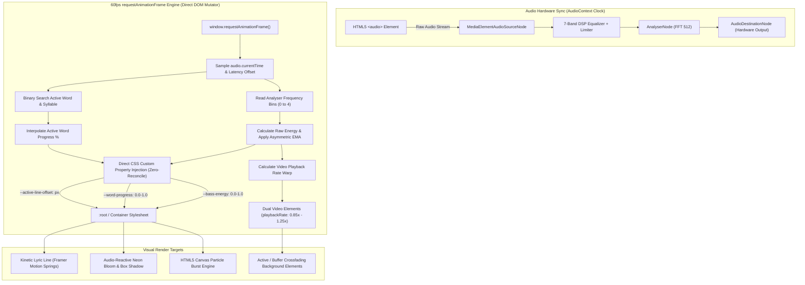
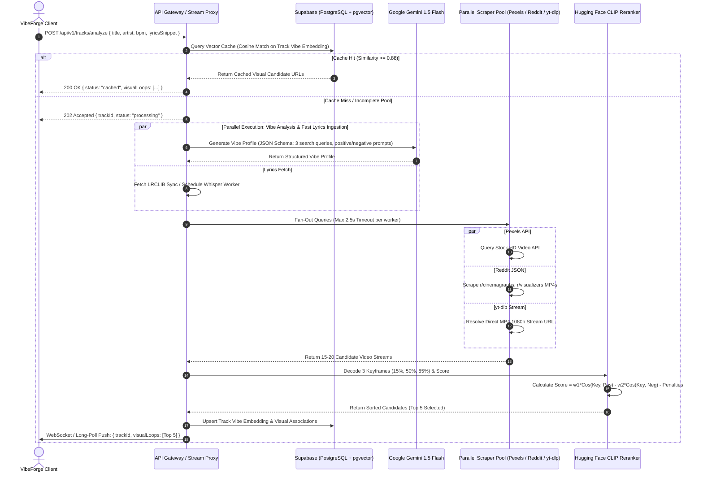

# 01. System Architecture Specification

## 1. Executive Topology

VibeForge is architectured as a decoupled, high-performance distributed system comprising a high-frequency **Client-Side Reactive Audio-Visual Engine** (React + Web Audio API + HTML5 Canvas) and an asynchronous **Multimodal Video Discovery & Ingestion Backend** (Node.js/TypeScript or Python/FastAPI microservices, Gemini 1.5 Flash, Hugging Face CLIP, and Supabase pgvector).

```
┌────────────────────────────────────────────────────────────────────────────────────────┐
│                                CLIENT WORKSTATION BROWSER                              │
│                                                                                        │
│   ┌─────────────────────┐       ┌──────────────────────┐       ┌───────────────────┐   │
│   │   HTML5 Audio DOM   │ ────► │  Web Audio DSP Graph │ ────► │ Speakers / Output │   │
│   └──────────┬──────────┘       └──────────┬───────────┘       └───────────────────┘   │
│              │ Clock Anchor                │ FFT Bins 0-4 (Sub-Bass)                   │
│              ▼                             ▼                                           │
│   ┌────────────────────────────────────────────────────┐                               │
│   │         60fps requestAnimationFrame Loop           │                               │
│   │  • Zero-Reconciliation CSS Variable Injection      │                               │
│   │  • Dynamic Sub-Bass Exponential Moving Average     │                               │
│   │  • Word-Level Syllable Progress Interpolation      │                               │
│   └──────────┬─────────────────────────────┬───────────┘                               │
│              │ CSS Variables               │ Alpha / PlaybackRate                      │
│              ▼                             ▼                                           │
│   ┌─────────────────────┐       ┌──────────────────────┐                               │
│   │ Framer Motion Lyric │       │ Dual-Video Crossfade │                               │
│   │  Typography Canvas  │       │ Background Player    │                               │
│   └─────────────────────┘       └──────────────────────┘                               │
└──────────────────────────────────────────▲─────────────────────────────────────────────┘
                                           │ Stream URLs / Timing Data
                                           │ (HTTP REST / WebSocket)
┌──────────────────────────────────────────▼─────────────────────────────────────────────┐
│                          ORCHESTRATION BACKEND & WORKERS                               │
│                                                                                        │
│   ┌────────────────────────────────────────────────────────────────────────────────┐   │
│   │                      API Gateway / Reverse Stream Proxy                        │   │
│   │               • CORS Stripping & 206 Partial Content Chunking                  │   │
│   │               • Session Ingestion & LRCLIB / Whisper Coordinator               │   │
│   └───────────┬────────────────────────────────────────────┬───────────────────────┘   │
│               │                                            │                           │
│               ▼                                            ▼                           │
│   ┌────────────────────────┐                  ┌────────────────────────┐               │
│   │  Lyrics Sync Worker    │                  │  Vibe Director (LLM)   │               │
│   │  • LRCLIB REST Client  │                  │  • Gemini 1.5 Flash    │               │
│   │  • faster-whisper Fall-│                  │  • Structured JSON     │               │
│   │    back (CUDA/float16) │                  │    Prompt Pipeline     │               │
│   └────────────────────────┘                  └───────────┬────────────┘               │
│                                                           │ 3 Search Queries           │
│                                                           ▼                            │
│                                               ┌────────────────────────┐               │
│                                               │ Parallel Scraper Pool  │               │
│                                               │ • Pexels Video API     │               │
│                                               │ • Pixabay Video API    │               │
│                                               │ • Reddit JSON API      │               │
│                                               │ • yt-dlp Stream Engine │               │
│                                               └───────────┬────────────┘               │
│                                                           │ Candidate MP4s             │
│                                                           ▼                            │
│                                               ┌────────────────────────┐               │
│                                               │  CLIP Vision Reranker  │               │
│                                               │  • Keyframe Extraction │               │
│                                               │  • Dual-Prompt Scoring │               │
│                                               │  • Text/Face Penalty   │               │
│                                               └───────────┬────────────┘               │
│                                                           │ Ranked Stream URLs         │
│                                                           ▼                            │
│                                               ┌────────────────────────┐               │
│                                               │ Supabase & pgvector DB │               │
│                                               │ • 512-dim Vector Cache │               │
│                                               │ • Track Vibe Records   │               │
│                                               └────────────────────────┘               │
└────────────────────────────────────────────────────────────────────────────────────────┘
```

---

## 2. Core Architectural Diagrams

### 2.1. Client-Side 60fps Audio/Visual Render Loop

The client execution engine maintains a strict separation between high-level React UI state and high-frequency rendering. React never re-renders during active audio playback. Instead, a dedicated `requestAnimationFrame` (rAF) loop reads from the Web Audio `AnalyserNode` and HTML5 audio time, directly modifying CSS custom variables and canvas context.



### 2.2. Asynchronous Multimodal Video Discovery Pipeline

The backend multimodal workflow ingests track metadata and audio characteristics, querying Gemini 1.5 Flash to synthesize cinematic scene prompts, executing a 2.5-second concurrent multi-source scrape, and passing candidate keyframes through a CLIP reranker.



---

## 3. Real-Time State Synchronization Specification

Maintaining millisecond-accurate alignment across audio DSP, typography animation, and dual-video playback requires establishing an authoritative clock and decoupling rendering from JavaScript event loop jitter.

### 3.1. Authoritative Clock Arbitration

The browser environment presents two distinct timing references:
1. `HTMLMediaElement.currentTime`: Reflects the decoded audio stream playhead in seconds. Subject to low-resolution tick intervals (often updated at only 15Hz to 30Hz depending on browser OS scheduling).
2. `AudioContext.currentTime`: A monotonically increasing hardware hardware-sample clock (derived from the audio hardware DAC sample rate, e.g., 44.1kHz or 48kHz). Highly precise ($<1\mu\text{s}$), but does not intrinsically track pauses, loops, or manual user seeking within an `<audio>` tag.

**Arbitration Protocol**:
* The `HTMLMediaElement` serves as the **Coarse Master Anchor**.
* The `AudioContext` serves as the **Sub-Frame Interpolation Driver**.
* Upon playback start or seeking:
  $$\Delta t_{\text{anchor}} = \text{audioElement.currentTime} - \text{audioContext.currentTime}$$
* The synthesized render playhead $T_{\text{render}}(t)$ evaluated at any rAF instant $t$ is calculated as:
  $$T_{\text{render}}(t) = \text{audioContext.currentTime} + \Delta t_{\text{anchor}} - t_{\text{latencyCompensation}}$$
  Where $t_{\text{latencyCompensation}} = \text{audioContext.outputLatency} + \text{audioContext.baseLatency}$.
* If drift $|\text{audioElement.currentTime} - (\text{audioContext.currentTime} + \Delta t_{\text{anchor}})| > 0.040\text{s}$ (40ms, indicating user scrubbing or buffer starvation), $\Delta t_{\text{anchor}}$ is instantly re-synchronized.

### 3.2. Decoupling High-Frequency Render Loop from React

React's reconciliation cycle (Virtual DOM diffing, fiber queueing, and commit phases) introduces variable latency (2ms to 35ms depending on component tree depth). Triggering React state updates (`useState`, `useReducer`) at 60Hz causes catastrophic frame drops and audio-visual de-synchronization.

**Implementation Invariant**:
* **React State Role**: Manages coarse lifecycle events only: track loading, pause/play toggle, EQ preset selection, error modals, and track metadata display.
* **Direct DOM / CSS Custom Property Role**: Handles all continuous values. Inside `requestAnimationFrame`:
  ```typescript
  // Zero-reconciliation binding: runs at display refresh rate (60Hz / 120Hz / 144Hz)
  const rootStyle = visualizerContainerRef.style;
  rootStyle.setProperty('--bass-energy', normalizedEmaBass.toFixed(4));
  rootStyle.setProperty('--word-progress', currentWordProgress.toFixed(4));
  rootStyle.setProperty('--line-distance-offset', `${activeLineScrollOffset}px`);
  ```

### 3.3. Dual-Video Crossfade Canvas Engine

To deliver unbroken, cinematic visual transitions without visible loading stalls or black flashes between video loops:
1. **Physical Layout**: Two identical HTML5 `<video>` elements (`#video-slot-a`, `#video-slot-b`) sit stacked inside a fixed background container under a WebGL/CSS contrast scrim.
2. **Buffering & Transition State Machine**:
   * **State A (Slot A Active)**: `Slot A` plays with `opacity: 1`, `zIndex: 1`. `Slot B` is paused or preloaded with the next candidate stream URL at `currentTime = 0`, `opacity: 0`, `zIndex: 2`.
   * **Trigger Point**: At $T_{\text{trigger}} = T_{\text{duration}} - T_{\text{crossfade}}$ (where $T_{\text{crossfade}} = 2.0\text{ seconds}$), or on song beat markers:
     1. `Slot B` issues `.play()`.
     2. An easing transition interpolates `Slot B` opacity from `0.0 -> 1.0` via a smooth raised-cosine curve:
        $$\alpha_B(t) = \frac{1 - \cos\left(\pi \cdot \frac{t - T_{\text{start}}}{T_{\text{crossfade}}}\right)}{2}, \quad \alpha_A(t) = 1.0 - \alpha_B(t)$$
     3. Upon completion ($t \ge T_{\text{start}} + T_{\text{crossfade}}$), `Slot A` is paused, reset to `currentTime = 0`, and designated as the new background buffer.

---

## 4. CORS Handling & Stream Proxy Architecture

### 4.1. The Web Audio API CORS Barrier

The Web Audio API strictly enforces the Same-Origin Policy. When connecting an HTML5 `<audio>` element to an `AudioContext` via `AudioContext.createMediaElementSource(audioElement)`:
* If the media resource originates from a third-party CDN or external host lacking explicit `Access-Control-Allow-Origin: *` headers, the browser's security model irrevocably **mutes the DSP graph** (outputting zeroed frequency buffers via `AnalyserNode.getByteFrequencyData()`) to prevent cross-origin audio fingerprinting.
* Directly loading video elements onto an HTML5 `<canvas>` via `CanvasRenderingContext2D.drawImage()` without proper CORS flags marks the canvas as **tainted**, throwing a `SecurityError` upon calling `.toDataURL()` or inspecting pixel buffers for CLIP keyframe reranking.

### 4.2. Dual-Route Resolution Architecture

VibeForge enforces a deterministic two-tier content delivery strategy:

```
[External Media URL] 
         │
         ├──► Direct CDN Access (If Headers Validate: Access-Control-Allow-Origin)
         │       • Low latency, zero server bandwidth consumption
         │       • audioElement.crossOrigin = "anonymous"
         │
         └──► Proxy Stream Routing (If External Headers Fail or yt-dlp Extracted)
                 • Route: GET /api/v1/stream/proxy?url=<encoded_url>
                 • Server-Side HTTP 206 Partial Content Forwarder
                 • Injects Permissive CORS Headers
                 • User-Agent spoofing for restricted hosts
```

### 4.3. Stream Proxy Implementation Specifications

The Backend Reverse Proxy must fulfill the following technical constraints:
1. **Range Request Forwarding**: Support HTTP `Range` headers (`bytes=start-end`) to allow client-side seeking within large audio and video files without downloading the entire asset.
2. **HTTP 206 Partial Content Handling**: Transparently pipe upstream byte-range responses back to the browser while maintaining correct `Content-Range`, `Accept-Ranges: bytes`, and `Content-Length` headers.
3. **Injected Header Schema**:
   ```http
   HTTP/1.1 206 Partial Content
   Access-Control-Allow-Origin: *
   Access-Control-Allow-Methods: GET, HEAD, OPTIONS
   Access-Control-Allow-Headers: Range, Accept-Encoding, X-Requested-With
   Access-Control-Expose-Headers: Content-Range, Content-Length, Accept-Ranges
   Accept-Ranges: bytes
   Content-Type: audio/mpeg  (or video/mp4)
   Content-Range: bytes 1048576-5242879/15728640
   Content-Length: 4194304
   Cache-Control: public, max-age=86400, stale-while-revalidate=3600
   ```

### 4.4. Graceful Degradation for CORS-Blocked Video Streams

In edge cases where a video stream CDN enforces IP-bound tokens or blocks canvas pixel extraction:
1. The video stream is routed directly to the native HTML5 `<video>` element (bypassing WebGL/Canvas pixel readback).
2. The UI continues hardware-accelerated playback with full opacity and CSS filters (`filter: blur(...) contrast(...)`).
3. Frame reranking for that candidate falls back to pre-computed vector embeddings stored in Supabase, eliminating the need for client-side keyframe image extraction.
