# 02. Audio DSP Engine Specification

## 1. Web Audio API Node Graph Architecture

The VibeForge Audio DSP subsystem executes entirely on the client workstation using the W3C Web Audio API hardware-accelerated processing graph. It accepts uncompressed or compressed PCM streams from an HTML5 `<audio>` element and channels audio through an active 7-stage filter network, a mastering-grade anti-clip limiter, and a high-resolution frequency analyzer before outputting to the hardware audio destination.

### 1.1. Complete Node Graph Flow Diagram

```mermaid
flowchart LR
    Source["MediaElementAudioSourceNode\n(HTML5 &lt;audio&gt;)"] --> F1["BiquadFilterNode\n(Sub-Bass LowShelf @ 60Hz)"]
    F1 --> F2["BiquadFilterNode\n(Punch Peaking @ 120Hz)"]
    
    subgraph Parametric_5Band ["5-Band Parametric Equalizer"]
        F2 --> P1["BiquadFilterNode\n(Low-Mid Peaking @ 125Hz)"]
        P1 --> P2["BiquadFilterNode\n(Mid Peaking @ 500Hz)"]
        P2 --> P3["BiquadFilterNode\n(High-Mid Peaking @ 1.5kHz)"]
        P3 --> P4["BiquadFilterNode\n(Presence Peaking @ 4kHz)"]
        P4 --> P5["BiquadFilterNode\n(Brilliance HighShelf @ 10kHz)"]
    end

    P5 --> Limiter["DynamicsCompressorNode\n(Brickwall Anti-Clip Limiter)"]
    Limiter --> Analyser["AnalyserNode\n(FFT 512, 256 Bins)"]
    Analyser --> Destination["AudioDestinationNode\n(System Hardware Output)"]

    Analyser -.->|getByteFrequencyData Bins 0-4| DSPWorker["Sub-Bass EMA Energy Extractor\n(60fps Visualizer Bus)"]
```



---

## 2. DSP Node Specifications & Parameter Ranges

Every node in the graph is strictly constrained within deterministic parameter bounds to ensure acoustic stability, prevent digital clipping, and eliminate filter blowup (Nyquist distortion).

### 2.1. Node Parameter Matrix

| Node Identifier | Node Type | Filter Mode | Center / Cutoff Freq ($f_0$) | Q Factor ($Q$) | Gain Range ($G$) | Default Value | Role / Acoustic Target |
| :--- | :--- | :--- | :--- | :--- | :--- | :--- | :--- |
| `subBassShelf` | `BiquadFilterNode` | `lowshelf` | $20\text{Hz} - 100\text{Hz}$ | $0.5 - 2.0$ (Fixed: $0.707$) | $-15\text{dB} \text{ to } +15\text{dB}$ | $0.0\text{dB}$ ($f_0 = 60\text{Hz}$) | Sub-harmonic warmth, deep 808 & kick foundation |
| `punchPeak` | `BiquadFilterNode` | `peaking` | $80\text{Hz} - 200\text{Hz}$ | $0.5 - 5.0$ (Default: $1.4$) | $-12\text{dB} \text{ to } +12\text{dB}$ | $0.0\text{dB}$ ($f_0 = 120\text{Hz}$) | Chest-thump kick drum impact, bassline attack |
| `eqBand1` | `BiquadFilterNode` | `peaking` | $100\text{Hz} - 250\text{Hz}$ | $0.7 - 4.0$ (Default: $1.0$) | $-12\text{dB} \text{ to } +12\text{dB}$ | $0.0\text{dB}$ ($f_0 = 125\text{Hz}$) | Low-mid body, male vocal resonance, warmth |
| `eqBand2` | `BiquadFilterNode` | `peaking` | $250\text{Hz} - 1000\text{Hz}$ | $0.7 - 4.0$ (Default: $1.0$) | $-12\text{dB} \text{ to } +12\text{dB}$ | $0.0\text{dB}$ ($f_0 = 500\text{Hz}$) | Boxiness reduction, snare body, acoustic timbre |
| `eqBand3` | `BiquadFilterNode` | `peaking` | $1.0\text{kHz} - 2.5\text{kHz}$ | $0.7 - 4.0$ (Default: $1.0$) | $-12\text{dB} \text{ to } +12\text{dB}$ | $0.0\text{dB}$ ($f_0 = 1.5\text{kHz}$) | Vocal bite, guitar cut, mix intelligibility |
| `eqBand4` | `BiquadFilterNode` | `peaking` | $2.5\text{kHz} - 8.0\text{kHz}$ | $0.7 - 4.0$ (Default: $1.0$) | $-12\text{dB} \text{ to } +12\text{dB}$ | $0.0\text{dB}$ ($f_0 = 4.0\text{kHz}$) | Presence, vocal articulation, sibilance control |
| `eqBand5` | `BiquadFilterNode` | `highshelf` | $8.0\text{kHz} - 16.0\text{kHz}$ | $0.5 - 2.0$ (Fixed: $0.707$) | $-15\text{dB} \text{ to } +15\text{dB}$ | $0.0\text{dB}$ ($f_0 = 10.0\text{kHz}$) | Air band, cymbal sheen, modern shimmer |
| `antiClipLimiter` | `DynamicsCompressorNode` | Non-linear Limiter | N/A | N/A | N/A | *See 2.2* | Prevents DAC hard-clipping and inter-sample peaks |
| `fftAnalyser` | `AnalyserNode` | Spectrum Engine | $0\text{Hz} - f_s/2$ | N/A | N/A | *See 2.3* | Discrete Fourier Transform for real-time visualization |

### 2.2. DynamicsCompressorNode (Anti-Clip Limiter) Specifications

To guarantee transparent signal safety when multiple EQ bands are boosted simultaneously:
* **`threshold`**: `-1.5 dB` (Engages immediately below the $0\text{dBFS}$ digital ceiling).
* **`knee`**: `3.0 dB` (Smooth soft-knee transition into limiting).
* **`ratio`**: `20.0` (Brickwall compression behavior).
* **`attack`**: `0.002 s` (2 milliseconds: rapid transient catching).
* **`release`**: `0.080 s` (80 milliseconds: rapid recovery without pumping distortion).

### 2.3. AnalyserNode Specifications

* **`fftSize`**: `512`
* **`frequencyBinCount`**: $N/2 = 256$
* **`smoothingTimeConstant`**: `0.75` (Native internal temporal damping)
* **`minDecibels`**: `-85 dB`
* **`maxDecibels`**: `-10 dB`

---

## 3. Sub-Bass Energy Extraction & Exponential Smoothing

Visual elements such as text glow, canvas particle bursts, and camera shake are driven by low-frequency energy. Raw FFT bins are prone to high-frequency frame jitter and noise. VibeForge extracts sub-bass energy across an ultra-low frequency window and stabilizes it using an asymmetric Exponential Moving Average (EMA).

### 3.1. Discrete Fourier Transform Bin Allocation Math

Given a hardware sampling frequency $f_s$ (nominally $44100\text{ Hz}$ or $48000\text{ Hz}$) and an FFT size $N = 512$, the frequency width of each discrete bin $\Delta f$ is:

$$\Delta f = \frac{f_s}{N} = \frac{48000\text{ Hz}}{512} = 93.75\text{ Hz} \quad \left(\text{or } \frac{44100\text{ Hz}}{512} \approx 86.13\text{ Hz}\right)$$

Evaluating bins $k \in [0, 4]$ at $f_s = 48000\text{ Hz}$:
* **Bin 0** ($0.0\text{ Hz} \le f < 93.75\text{ Hz}$): DC component and deep sub-bass ($20-60\text{Hz}$).
* **Bin 1** ($93.75\text{ Hz} \le f < 187.5\text{ Hz}$): Fundamental kick drum punch and bass guitar attack.
* **Bin 2** ($187.5\text{ Hz} \le f < 281.25\text{ Hz}$): Upper bass / lower midrange body.
* **Bin 3** ($281.25\text{ Hz} \le f < 375.0\text{ Hz}$): Mud/warmth transition band.
* **Bin 4** ($375.0\text{ Hz} \le f < 468.75\text{ Hz}$): Lower mid frequencies.

### 3.2. Sub-Bass Extraction & Weighted Normalization

The raw byte array returned by `analyser.getByteFrequencyData(frequencyDataArray)` maps decibel values linearly into an unsigned 8-bit integer range $v_k \in [0, 255]$:

$$v_{\text{norm}, k} = \frac{v_k}{255.0} \in [0.0, 1.0]$$

Sub-bass energy $E_{\text{raw}}$ is computed by applying an aggressive low-pass spectral weighting vector $\mathbf{w} = [0.40, 0.35, 0.15, 0.07, 0.03]$:

$$E_{\text{raw}}[t] = \sum_{k=0}^{4} w_k \cdot \left(\frac{v_k[t]}{255.0}\right)$$

To accentuate musical dynamics and silence low-level background noise, a non-linear noise gate and dynamic power curve are applied:

$$E_{\text{gated}}[t] = \begin{cases} 0, & \text{if } E_{\text{raw}}[t] < 0.08 \\ \left(\frac{E_{\text{raw}}[t] - 0.08}{1.0 - 0.08}\right)^{1.4}, & \text{if } E_{\text{raw}}[t] \ge 0.08 \end{cases}$$

### 3.3. Asymmetric Dual-Coefficient EMA Smoothing

Using a standard symmetrical filter creates an unresolvable trade-off: fast response introduces frame stutter, while heavy smoothing introduces visual lag behind kick hits. VibeForge resolves this using an **Asymmetric Attack/Decay EMA**:

$$E_{\text{EMA}}[t] = \alpha \cdot E_{\text{gated}}[t] + (1 - \alpha) \cdot E_{\text{EMA}}[t - 1]$$

Where the smoothing coefficient $\alpha$ is conditionally selected based on transient direction:

$$\alpha = \begin{cases} \alpha_{\text{attack}} = 0.65, & \text{if } E_{\text{gated}}[t] > E_{\text{EMA}}[t - 1] \quad (\text{Fast attack: Snappy transient reaction}) \\ \alpha_{\text{decay}} = 0.15, & \text{if } E_{\text{gated}}[t] \le E_{\text{EMA}}[t - 1] \quad (\text{Slow decay: Smooth organic fadeout}) \end{cases}$$

The resulting $E_{\text{EMA}} \in [0.0, 1.0]$ provides jitter-free visual modulation at a solid 60fps.

---

## 4. Factory Equalizer Presets Specification

VibeForge includes 5 mathematically tuned EQ profiles. Parameter values represent exact filter gain changes in decibels ($\text{dB}$):

```
Preset Comparison Curves:
[Flat]            ─── ─── ─── ─── ─── ─── ─── (0dB transparent reference)
[Sub-Bass]        ▲▲▲  ▲  ─── ─── ─── ─── ─── (+9dB sub, +4.5dB punch)
[Lo-Fi]           ▲▲   ▲  ─── ─── ───  ▼   ▼▼ (+5dB warmth, -6dB rolled highs)
[Vocal Clarity]   ▼▼   ▼  ─── ───  ▲  ▲▲▲  ▲  (-5dB bass, +6dB presence)
[V-Shape Arena]   ▲▲▲  ▲   ▼   ▼  ───  ▲  ▲▲▲ (+8dB sub, -3dB mids, +7dB sheen)
```

### 4.1. Exact Numerical Preset Matrix

| Parameter / Node | Preset 1: Flat | Preset 2: Sub-Bass Rattler | Preset 3: Late Night Lo-Fi | Preset 4: Vocal Clarity | Preset 5: V-Shape Arena |
| :--- | :--- | :--- | :--- | :--- | :--- |
| **Sub-Bass Shelf (60Hz)** | `0.0 dB` | `+9.0 dB` | `+5.0 dB` | `-6.0 dB` | `+8.0 dB` |
| **Punch Peak (120Hz)** | `0.0 dB` | `+4.5 dB` | `+3.0 dB` | `-3.0 dB` | `+4.0 dB` |
| **EQ Band 1 (125Hz)** | `0.0 dB` | `+2.0 dB` | `+2.0 dB` | `-2.0 dB` | `-1.5 dB` |
| **EQ Band 2 (500Hz)** | `0.0 dB` | `-1.5 dB` | `+1.0 dB` | `-3.5 dB` | `-4.0 dB` |
| **EQ Band 3 (1.5kHz)** | `0.0 dB` | `-2.0 dB` | `-2.5 dB` | `+3.5 dB` | `-2.5 dB` |
| **EQ Band 4 (4.0kHz)** | `0.0 dB` | `+1.0 dB` | `-4.0 dB` | `+6.0 dB` | `+3.5 dB` |
| **EQ Band 5 (10.0kHz)** | `0.0 dB` | `+1.5 dB` | `-7.5 dB` | `+2.5 dB` | `+7.0 dB` |
| **Target Genre / Vibe** | Studio Reference / Unaltered | Trap / Dubstep / Hip-Hop | Lo-Fi Chill / Vinyl / Ambient | Acoustic / Podcast / Ballad | Synthwave / Rock / Arena EDM |

---

## 5. DSP Manager Reference Implementation (TypeScript)

The following production-ready class coordinates node instantiation, preset switching, parameter scheduling, and the sub-bass energy extraction loop:

```typescript
export interface EqPreset {
  name: string;
  subBass: number; // 60Hz LowShelf
  punch: number;   // 120Hz Peaking
  band125: number; // 125Hz Peaking
  band500: number; // 500Hz Peaking
  band1500: number;// 1.5kHz Peaking
  band4000: number;// 4kHz Peaking
  band10k: number; // 10kHz HighShelf
}

export const FACTORY_PRESETS: Record<string, EqPreset> = {
  flat: { name: 'Flat', subBass: 0, punch: 0, band125: 0, band500: 0, band1500: 0, band4000: 0, band10k: 0 },
  subBassRattler: { name: 'Sub-Bass Rattler', subBass: 9.0, punch: 4.5, band125: 2.0, band500: -1.5, band1500: -2.0, band4000: 1.0, band10k: 1.5 },
  lateNightLoFi: { name: 'Late Night Lo-Fi', subBass: 5.0, punch: 3.0, band125: 2.0, band500: 1.0, band1500: -2.5, band4000: -4.0, band10k: -7.5 },
  vocalClarity: { name: 'Vocal Clarity', subBass: -6.0, punch: -3.0, band125: -2.0, band500: -3.5, band1500: 3.5, band4000: 6.0, band10k: 2.5 },
  vShapeArena: { name: 'V-Shape Arena', subBass: 8.0, punch: 4.0, band125: -1.5, band500: -4.0, band1500: -2.5, band4000: 3.5, band10k: 7.0 },
};

export class AudioDspEngine {
  private ctx: AudioContext | null = null;
  private sourceNode: MediaElementAudioSourceNode | null = null;
  private subBassFilter!: BiquadFilterNode;
  private punchFilter!: BiquadFilterNode;
  private eqBands: BiquadFilterNode[] = [];
  private limiterNode!: DynamicsCompressorNode;
  private analyserNode!: AnalyserNode;
  
  private freqDataBuffer: Uint8Array = new Uint8Array(256);
  private currentEmaBass: number = 0;
  private readonly attackAlpha: number = 0.65;
  private readonly decayAlpha: number = 0.15;
  private readonly spectralWeights: number[] = [0.40, 0.35, 0.15, 0.07, 0.03];

  public initialize(audioElement: HTMLMediaElement): void {
    if (this.ctx) return;

    const AudioContextClass = window.AudioContext || (window as unknown as { webkitAudioContext: typeof AudioContext }).webkitAudioContext;
    this.ctx = new AudioContextClass({ latencyHint: 'interactive' });
    this.sourceNode = this.ctx.createMediaElementSource(audioElement);

    // 1. Sub-Bass LowShelf (60Hz)
    this.subBassFilter = this.ctx.createBiquadFilter();
    this.subBassFilter.type = 'lowshelf';
    this.subBassFilter.frequency.value = 60;
    this.subBassFilter.gain.value = 0;

    // 2. Punch Peaking (120Hz)
    this.punchFilter = this.ctx.createBiquadFilter();
    this.punchFilter.type = 'peaking';
    this.punchFilter.frequency.value = 120;
    this.punchFilter.Q.value = 1.4;
    this.punchFilter.gain.value = 0;

    // 3. 5-Band Parametric EQ
    const frequencies = [125, 500, 1500, 4000, 10000];
    const types: BiquadFilterType[] = ['peaking', 'peaking', 'peaking', 'peaking', 'highshelf'];

    this.eqBands = frequencies.map((freq, idx) => {
      const filter = this.ctx!.createBiquadFilter();
      filter.type = types[idx];
      filter.frequency.value = freq;
      filter.Q.value = idx === 4 ? 0.707 : 1.0;
      filter.gain.value = 0;
      return filter;
    });

    // 4. DynamicsCompressorNode (Anti-Clip Limiter)
    this.limiterNode = this.ctx.createDynamicsCompressor();
    this.limiterNode.threshold.value = -1.5;
    this.limiterNode.knee.value = 3.0;
    this.limiterNode.ratio.value = 20.0;
    this.limiterNode.attack.value = 0.002;
    this.limiterNode.release.value = 0.080;

    // 5. AnalyserNode
    this.analyserNode = this.ctx.createAnalyser();
    this.analyserNode.fftSize = 512;
    this.analyserNode.smoothingTimeConstant = 0.75;
    this.analyserNode.minDecibels = -85;
    this.analyserNode.maxDecibels = -10;
    this.freqDataBuffer = new Uint8Array(this.analyserNode.frequencyBinCount);

    // Assemble Graph
    this.sourceNode.connect(this.subBassFilter);
    this.subBassFilter.connect(this.punchFilter);
    
    let previousNode: AudioNode = this.punchFilter;
    for (const band of this.eqBands) {
      previousNode.connect(band);
      previousNode = band;
    }

    previousNode.connect(this.limiterNode);
    this.limiterNode.connect(this.analyserNode);
    this.analyserNode.connect(this.ctx.destination);
  }

  public applyPreset(presetKey: keyof typeof FACTORY_PRESETS, rampTimeSeconds = 0.05): void {
    if (!this.ctx) return;
    const p = FACTORY_PRESETS[presetKey];
    if (!p) return;

    const t = this.ctx.currentTime + rampTimeSeconds;
    this.subBassFilter.gain.linearRampToValueAtTime(p.subBass, t);
    this.punchFilter.gain.linearRampToValueAtTime(p.punch, t);
    this.eqBands[0].gain.linearRampToValueAtTime(p.band125, t);
    this.eqBands[1].gain.linearRampToValueAtTime(p.band500, t);
    this.eqBands[2].gain.linearRampToValueAtTime(p.band1500, t);
    this.eqBands[3].gain.linearRampToValueAtTime(p.band4000, t);
    this.eqBands[4].gain.linearRampToValueAtTime(p.band10k, t);
  }

  public getSubBassEnergy(): number {
    if (!this.analyserNode) return 0;
    this.analyserNode.getByteFrequencyData(this.freqDataBuffer);

    let rawEnergy = 0;
    for (let i = 0; i < 5; i++) {
      rawEnergy += (this.freqDataBuffer[i] / 255.0) * this.spectralWeights[i];
    }

    // Apply Noise Gate & Dynamic Curve
    let gated = 0;
    if (rawEnergy >= 0.08) {
      gated = Math.pow((rawEnergy - 0.08) / 0.92, 1.4);
    }

    // Asymmetric EMA Smoothing
    const alpha = gated > this.currentEmaBass ? this.attackAlpha : this.decayAlpha;
    this.currentEmaBass = alpha * gated + (1.0 - alpha) * this.currentEmaBass;

    return this.currentEmaBass;
  }

  public async resumeContext(): Promise<void> {
    if (this.ctx && this.ctx.state === 'suspended') {
      await this.ctx.resume();
    }
  }
}
```
