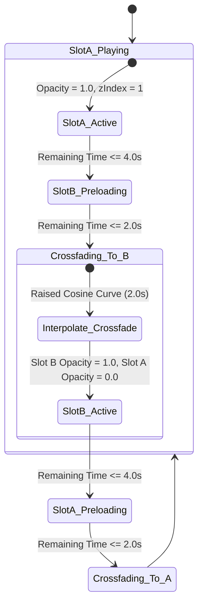

# 04. AI Multimodal Video Discovery & Reranking Specification

## 1. Executive Pipeline Architecture

The VibeForge visual subsystem operates as an autonomous, 3-stage multimodal pipeline designed to discover, aggregate, score, and stream cinematic background video loops matching the mood, lyrical themes, and tempo of any audio track.

```
┌─────────────────────────────────────────────────────────────────────────────┐
│                       STAGE 1: VIBE DIRECTOR (LLM)                          │
│                     Google Gemini 1.5 Flash Engine                          │
│  • Input: Song Title, Artist, Genre, BPM, Key, Lyrics Snippets, Energy Curve│
│  • Structured JSON Output: 3 Visual Queries + Pos/Neg Aesthetic Prompts     │
└──────────────────────────────────────┬──────────────────────────────────────┘
                                       │
                                       ▼ (Parallel 2.5s Fan-Out)
┌─────────────────────────────────────────────────────────────────────────────┐
│                 STAGE 2: MULTI-SOURCE SCRAPER AGGREGATION                   │
│                                                                             │
│  ┌──────────────────┐  ┌──────────────────┐  ┌───────────────────────────┐  │
│  │ Pexels Video API │  │ Pixabay Vid API  │  │ Reddit Cinemagraph Feeds  │  │
│  └────────┬─────────┘  └────────┬─────────┘  └─────────────┬─────────────┘  │
│           │                     │                          │                │
│           └─────────────────────┼──────────────────────────┘                │
│                                 │ Direct Stream Resolution                  │
│                                 ▼                                           │
│                 ┌───────────────────────────────┐                           │
│                 │ yt-dlp Direct Headless Stream │                           │
│                 └───────────────┬───────────────┘                           │
└─────────────────────────────────┼───────────────────────────────────────────┘
                                  │ 15-20 Candidate Video Streams
                                  ▼
┌─────────────────────────────────────────────────────────────────────────────┐
│                    STAGE 3: MULTIMODAL CLIP RERANKING                       │
│              Hugging Face CLIP (Xenova/clip-vit-base-patch32)               │
│  • Keyframe Extraction: 3 Temporal Slices (15%, 50%, 85%)                   │
│  • Scoring: FinalScore = w1*Cos(Key, Pos) - w2*Cos(Key, Neg) - Penalties    │
│  • Auto-Pruning: Watermarks, Baked-in Text, High Luminance, Talking Heads   │
└─────────────────────────────────┬───────────────────────────────────────────┘
                                  │ Top 5 Highest-Scoring Loops
                                  ▼
┌─────────────────────────────────────────────────────────────────────────────┐
│                  STAGE 4: DUAL-VIDEO CROSSFADE PLAYER                       │
│  • A/B Video Buffering • Cosine Crossfade • Radial Vignette Contrast Scrim  │
│  • Sub-Bass Audio-Reactive PlaybackRate Modulation (0.85x - 1.25x)          │
└─────────────────────────────────────────────────────────────────────────────┘
```

---

## 2. Stage 1: Gemini 1.5 Flash Vibe Director

The Vibe Director converts semantic musical metadata into deterministic visual search queries and aesthetic evaluation vectors. It runs on `gemini-1.5-flash` with response schema enforcement (`application/json`).

### 2.1. System Instruction & Prompt Template

```markdown
SYSTEM INSTRUCTION:
You are the Principal Cinematographer and Visual Director for VibeForge, an ultra-premium, audio-reactive concert visualization engine.
Your mission is to translate musical input (track metadata, genre, tempo, key, and lyrical semantics) into precise, atmospheric visual search queries and multimodal aesthetic prompts.

Design Philosophy:
- Favor dark, moody, cinematic, abstract, atmospheric, neon, cyberpunk, slow-motion, landscape, or futuristic architectural visuals.
- Strictly AVOID literal narrative depictions, cheesy stock imagery, bright white daylight scenes, corporate office footage, people looking directly into the camera, or talking heads.
- Ensure the aesthetic ensures 100% readability for pure-white overlay kinetic lyrics.
- Output ONLY valid JSON conforming precisely to the specified schema.
```

### 2.2. Gemini Structured Output JSON Schema

```json
{
  "$schema": "http://json-schema.org/draft-07/schema#",
  "title": "VibeProfileResponse",
  "type": "object",
  "properties": {
    "vibeSummary": {
      "type": "string",
      "description": "A 2-sentence poetic summary of the visual aesthetic and emotional resonance."
    },
    "pacing": {
      "type": "string",
      "enum": ["slow_atmospheric", "medium_groove", "fast_kinetic", "chaotic_strobe"],
      "description": "Target camera motion and scene velocity matching track tempo."
    },
    "colorPalette": {
      "type": "object",
      "properties": {
        "primaryHex": { "type": "string", "pattern": "^#[0-9A-Fa-f]{6}$" },
        "secondaryHex": { "type": "string", "pattern": "^#[0-9A-Fa-f]{6}$" },
        "accentNeonHex": { "type": "string", "pattern": "^#[0-9A-Fa-f]{6}$" }
      },
      "required": ["primaryHex", "secondaryHex", "accentNeonHex"]
    },
    "searchQueries": {
      "type": "array",
      "minItems": 3,
      "maxItems": 3,
      "items": {
        "type": "object",
        "properties": {
          "query": { "type": "string", "description": "Concise 2-4 word search term optimized for video APIs." },
          "intent": { "type": "string", "enum": ["abstract_texture", "atmospheric_landscape", "rhythmic_motion"] }
        },
        "required": ["query", "intent"]
      }
    },
    "clipPrompts": {
      "type": "object",
      "properties": {
        "positivePrompt": {
          "type": "string",
          "description": "Rich descriptive prompt capturing lighting, geometry, camera angle, and mood for CLIP positive cosine scoring."
        },
        "negativePrompt": {
          "type": "string",
          "description": "Strict exclusion prompt detailing unwanted artifacts (watermarks, bright white light, talking heads, UI text)."
        }
      },
      "required": ["positivePrompt", "negativePrompt"]
    }
  },
  "required": ["vibeSummary", "pacing", "colorPalette", "searchQueries", "clipPrompts"]
}
```

### 2.3. Example Model Invocation & Structured Output

**Input Context**:
* **Track**: *Blinding Lights* by The Weeknd
* **BPM**: 171 | **Key**: F Minor | **Genre**: Synthwave / Synthpop
* **Lyrics Theme**: Fast-paced night driving, neon-lit empty city streets, emotional longing, adrenaline.

**Gemini Output**:
```json
{
  "vibeSummary": "A high-velocity nocturnal descent into rain-slicked Tokyo streets illuminated by electric crimson and cyan neon signs, reflecting solitary velocity and retro-futuristic longing.",
  "pacing": "fast_kinetic",
  "colorPalette": {
    "primaryHex": "#0b0c10",
    "secondaryHex": "#1f2833",
    "accentNeonHex": "#ff0055"
  },
  "searchQueries": [
    { "query": "cyberpunk city night rain", "intent": "rhythmic_motion" },
    { "query": "neon retro highway night driving", "intent": "atmospheric_landscape" },
    { "query": "abstract red laser grid loop", "intent": "abstract_texture" }
  ],
  "clipPrompts": {
    "positivePrompt": "Cinematic 4k 60fps night footage, dark cyberpunk metropolis, neon red and deep indigo reflections, wet asphalt, anamorphic lens flare, moody retro-futuristic atmosphere, high contrast.",
    "negativePrompt": "Bright daylight, sunny sky, white background, talking face, podcast host, corporate presentation, watermarks, stock logo, low resolution, blurry, subtitles, karaoke text overlay."
  }
}
```

---

## 3. Stage 2: Parallel Scraper Aggregation Engine

To guarantee real-time visual playback without stalling the user, all scrapers run in parallel with an enforced **2.5-second hard timeout budget** per source.

```
                         ┌─► Pexels API (Timeout: 2.5s) ────► 5 Candidates ┐
                         │                                                 │
[Search Queries Array] ──┼─► Pixabay API (Timeout: 2.5s) ───► 5 Candidates ┼─► [Candidate Pool]
                         │                                                 │   (15-20 Streams)
                         ├─► Reddit Feeds (Timeout: 2.5s) ──► 5 Candidates │
                         │                                                 │
                         └─► yt-dlp Stream (Timeout: 2.5s) ─► 3 Candidates ┘
```

### 3.1. Scraper Adapter Specifications

#### 1. Pexels Video API
* **Endpoint**: `GET https://api.pexels.com/videos/search`
* **Query Parameters**:
  `query=<encoded_query>&orientation=landscape&size=medium&per_page=6`
* **Filter Rule**: Select `video_files` where `quality === 'hd'` and `width === 1920` (or `width === 1280`). Extract direct `.mp4` link with standard CDN streaming.

#### 2. Pixabay Video API
* **Endpoint**: `GET https://pixabay.com/api/videos/`
* **Query Parameters**:
  `key=<API_KEY>&q=<encoded_query>&video_type=animation,film&per_page=6`
* **Filter Rule**: Parse `videos.medium.url` or `videos.large.url`. Ensure `duration` is between $5\text{s}$ and $60\text{s}$.

#### 3. Reddit JSON Feeds
* **Target Subreddits**: `r/cinemagraphs`, `r/visualizers`, `r/Cyberpunk`, `r/aestheticvideos`
* **Endpoint**: `GET https://www.reddit.com/r/<sub_name>/search.json?q=<query>&restrict_sr=1&sort=top&t=year&limit=10`
* **Headers**: `User-Agent: web:com.vibeforge.visualizer:v1.0.0 (by /u/vibeforge_app)`
* **Filter Rule**: Extract items where `post_hint === 'hosted:video'` and obtain the direct audio-free video feed from `media.reddit_video.fallback_url`.

#### 4. Headless yt-dlp Direct Stream Resolver
* **CLI Execution**:
  ```bash
  yt-dlp "ytsearch3:<query> 4k 60fps loop visualizer" \
    --dump-json \
    --default-search "ytsearch" \
    --format "bestvideo[ext=mp4][height<=1080][fps>=30]/bestvideo[ext=mp4][height<=1080]" \
    --max-downloads 3 \
    --no-playlist \
    --socket-timeout 2.5
  ```
* **Extraction**: Reads `url` from emitted JSON output (direct Google Video CDN stream URL).

---

## 4. Stage 3: Multimodal CLIP Vision Reranker

Raw scrapers frequently return irrelevant, branded, or high-luminance video files that destroy typography readability. The candidate pool is pruned and ranked using local CLIP embeddings (`Xenova/clip-vit-base-patch32` executed via ONNX Runtime / WebAssembly or Python worker).

### 4.1. Keyframe Temporal Extraction

For each candidate video, 3 temporal frames are extracted at relative durations:
$$\tau \in \{0.15 \times T_{\text{duration}}, \, 0.50 \times T_{\text{duration}}, \, 0.85 \times T_{\text{duration}}\}$$
Extraction is performed via an accelerated ffmpeg worker:
```bash
ffmpeg -ss <timestamp> -i "<stream_url>" -vframes 1 -vf "scale=224:224:force_original_aspect_ratio=decrease,pad=224:224:(ow-iw)/2:(oh-ih)/2" -f image2 -
```

### 4.2. Mathematical Scoring Formula

Let:
* $\mathbf{v}_k \in \mathbb{R}^{512}$ be the $L_2$-normalized visual embedding of keyframe $k \in \{1, 2, 3\}$.
* $\mathbf{t}_{\text{pos}} \in \mathbb{R}^{512}$ be the $L_2$-normalized text embedding of Gemini's `positivePrompt`.
* $\mathbf{t}_{\text{neg}} \in \mathbb{R}^{512}$ be the $L_2$-normalized text embedding of Gemini's `negativePrompt`.

The cosine similarity between visual and text vectors is:
$$\cos(\mathbf{v}, \mathbf{t}) = \frac{\mathbf{v} \cdot \mathbf{t}}{\|\mathbf{v}\|_2 \|\mathbf{t}\|_2} = \mathbf{v} \cdot \mathbf{t} \quad (\text{since vectors are unit-normalized})$$

The raw aesthetic score for each keyframe is:
$$S_k = w_1 \cdot \cos(\mathbf{v}_k, \mathbf{t}_{\text{pos}}) - w_2 \cdot \cos(\mathbf{v}_k, \mathbf{t}_{\text{neg}})$$
Where weights are calibrated to:
$$w_1 = 0.70, \quad w_2 = 0.45$$

### 4.3. Automated Artifact & Luminance Penalties

To ensure text legibility and brand hygiene, additional deterministic penalties are computed directly on image pixel buffers:

1. **Mean Luminance Penalty ($P_{\text{lum}}$)**: White lyrics cannot be read over bright scenes.
   $$\mu_{\text{lum}} = \frac{1}{M} \sum_{p=1}^M \left(0.2126 R_p + 0.7152 G_p + 0.0722 B_p\right)$$
   $$P_{\text{lum}} = \begin{cases} 0.0, & \text{if } \mu_{\text{lum}} \le 110 \\ \left(\frac{\mu_{\text{lum}} - 110}{255 - 110}\right) \times 0.50, & \text{if } \mu_{\text{lum}} > 110 \end{cases}$$

2. **OCR / Edge Watermark Penalty ($P_{\text{text}}$)**:
   A lightweight edge-detector (Sobel filter over corner regions: bottom-right and top-left) flags burned-in channel watermarks or karaoke subtitles. If edge density in the bottom 20% of the frame exceeds threshold $\theta_{\text{edge}}$, a hard penalty of $P_{\text{text}} = 0.40$ is subtracted.

### 4.4. Aggregate Video Score

$$\text{FinalScore} = \left(\frac{1}{3} \sum_{k=1}^3 S_k\right) - P_{\text{lum}} - P_{\text{text}}$$

Candidates are sorted descending by `FinalScore`. The top 5 candidates with $\text{FinalScore} \ge 0.42$ are persisted to Supabase and forwarded to the client player.

---

## 5. Dual-Video Crossfade Player Specification

The client player renders continuous video loops without pausing or visual hitches between disparate video streams.

### 5.1. Dual-Slot State Machine



### 5.2. Radial Vignette & Contrast Overlay Specification

To guarantee $100\%$ white lyric readability across any video frame, the background layer sits beneath a multi-tiered CSS composite scrim:

```css
/* Deep radial vignette + linear contrast scrim */
.video-contrast-overlay {
  position: absolute;
  inset: 0;
  pointer-events: none;
  z-index: 2;
  
  /* Radial center clarity with deep perimeter darkening */
  background: 
    radial-gradient(
      ellipse at center,
      rgba(11, 12, 16, 0.35) 0%,
      rgba(11, 12, 16, 0.75) 70%,
      rgba(11, 12, 16, 0.95) 100%
    ),
    /* Vertical linear gradient anchoring lyrics in bottom/center thirds */
    linear-gradient(
      180deg,
      rgba(11, 12, 16, 0.60) 0%,
      transparent 30%,
      transparent 70%,
      rgba(11, 12, 16, 0.85) 100%
    );
  
  backdrop-filter: blur(calc(var(--bass-energy, 0) * 8px));
  mix-blend-mode: multiply;
}
```

### 5.3. Audio-Reactive Video PlaybackRate Modulation

To create a subconscious synchronization between visual scene velocity and track rhythm, the active video element's `playbackRate` dynamically tracks sub-bass energy ($E_{\text{EMA}}$):

$$R_{\text{target}}[t] = 1.0 + \left(E_{\text{EMA}}[t] - 0.40\right) \times 0.35$$

Clamped strictly within hardware-safe boundaries:
$$R_{\text{effective}}[t] = \text{clamp}(R_{\text{target}}[t], \, 0.85, \, 1.25)$$

* During heavy 808 drops, background camera motion surges forward up to $1.25\times$.
* During ambient breakdown sections ($E_{\text{EMA}} \approx 0$), camera motion settles into a slow-motion glide ($0.85\times$).
* PlaybackRate adjustments are scheduled every $100\text{ms}$ with smooth rate ramping to prevent audio pitch artifacts (all background videos are permanently muted with `.muted = true` and `.volume = 0`).
